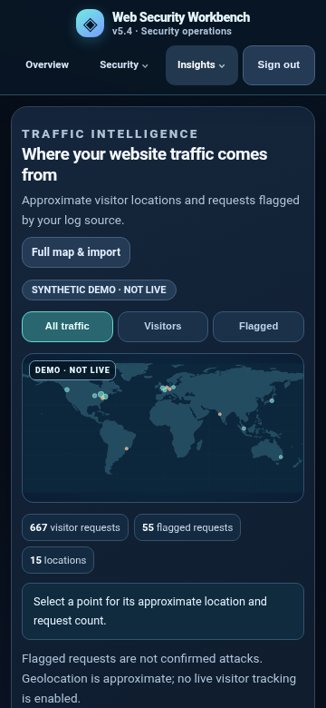
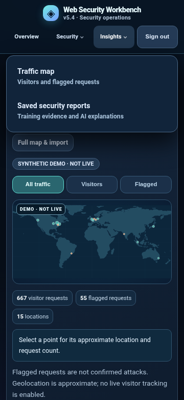
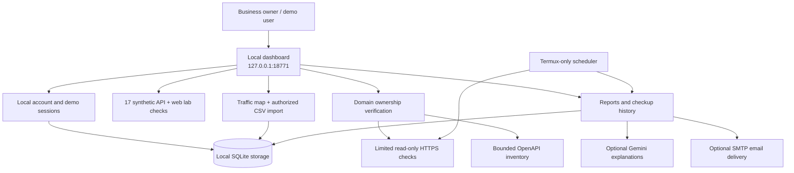

# Web Security Workbench

**AI-assisted web and API security monitoring — a mobile-first cybersecurity prototype for small businesses.**

  

> **Project status:** Working local development prototype, **not** a production SaaS service or a validated commercial penetration-testing engine. Active vulnerability demonstrations run only against fictional localhost fixtures. No affiliation with or endorsement by Fortinet or other security vendors is claimed.

## Overview

Web Security Workbench explores a simple idea: a small-business owner should be able to check the security posture of their website, understand the results, and track changes without needing to operate a full security team.

The project brings together a customer-facing dashboard, local API/web security training labs, limited read-only checks for verified websites, optional AI explanations, scheduled checkups, reporting, and a traffic-intelligence visualization.

### Interface previews

| Map-first mobile dashboard | Mobile Insights dropdown |
|:--:|:--:|
|  |  |

*Development previews using synthetic traffic data; these are not live attack or visitor locations.*

## Current capabilities

| Area | What is implemented | Scope / limitation |
|---|---|---|
| **Unified security center** | 17 API and web security training checks, grouped in one interface | Synthetic vulnerable/fixed localhost applications only |
| **API inventory** | Bounded, read-only OpenAPI/Swagger document discovery | Fixed paths on ownership-verified websites; not API exploitation |
| **Website checkups** | Limited HTTPS/TLS and security-header observations | Read-only; does not certify website security |
| **AI assistance** | Optional Gemini-generated explanations and security Q&A | Requires user configuration; not an autonomous attack agent |
| **Customer experience** | Local accounts, one-click demo, responsive navigation, in-place feedback, saved reports | Local prototype, not production multi-tenant authentication |
| **Scheduling** | Daily, weekly, or monthly checkups | Runs only while the Termux service is active |
| **Notifications** | Optional SMTP reports and availability alerts | Email provider must be configured; demo accounts never send email |
| **Traffic intelligence** | Interactive map, filters, and account-scoped CSV import | Demo uses synthetic points; real data requires authorized log exports; no live collector |
| **Reports** | Saved checkup evidence, downloadable JSON, printable HTML | Evidence reflects the limited checks performed |

## Security training coverage: 17 modules

The active security suite compares deliberately vulnerable behavior, corrected behavior, and a legitimate control request. It is designed for reproducible **training**, not claims about real customer vulnerabilities.

### API security (10)

1. Broken Object Level Authorization (**BOLA**)
2. Broken Function Level Authorization (**BFLA**)
3. Mass assignment / property authorization
4. Expired API token handling
5. SQL injection in an API query
6. Server-Side Request Forgery (**SSRF**)
7. API rate limiting
8. Business-logic validation
9. Excessive API data exposure
10. Undocumented API endpoints / inventory

### Web application security (7)

1. Reflected HTML injection indicator (not a full browser-executed XSS proof)
2. Cross-Site Request Forgery (**CSRF**)
3. Expired session handling
4. Unsafe file upload policy
5. Path traversal
6. Password-reset authorization
7. Missing browser security headers

## Architecture



**Data boundaries:** Lab checks never run against arbitrary internet targets. Real website checks require proof of domain control and are limited to low-impact, read-only operations. The traffic map does not identify confirmed attackers; IP-based geography is approximate, and imported logs must be authorized.

## Running the existing Android / Termux installation

This repository is a **source-code snapshot** of an existing v5.4 installation, not a self-contained public deployment package. It deliberately excludes customer databases, `.env` configuration files, API credentials, and operational reports. A clean deployment requires the project's base installation and incremental upgrades.

For an installation that is already configured on the Android device:

```bash
cd ~/web-app-pentest

# Check the running service:
curl -fsS http://127.0.0.1:18771/health

# If a restart is needed and the v5.4 upgrade directory remains installed:
bash ~/workbench-v5.4-install/start_v5_4.sh
```

Open **http://127.0.0.1:18771/** in the phone's browser and select **Explore demo — no sign-up**. The demo uses fictional websites, findings, and traffic; no real target is scanned.

### Automated regression tests

```bash
cd ~/web-app-pentest
python -m unittest -q \
  test_monitor.py test_v5_suite.py test_v5_ux.py \
  test_v5_traffic.py test_v5_4.py
```

Test results depend on the installed dependencies and the Android/Termux environment. The latest development work included additional local tests; this README does not claim independent third-party validation.

## Key source files

| File | Responsibility |
|---|---|
| `monitor_portal.py` | Local web portal, account flows, scheduled checkups and reporting |
| `v5_suite.py` | 17 synthetic API/web training fixtures and comparisons |
| `v5_features.py` | Security Center integration and limited documented API discovery |
| `v5_traffic.py` | Authorized traffic CSV handling and map data |
| `v5_ux.py`, `v5_4_ui.py` | Mobile layout and interaction enhancements |
| `sql_copilot.py` | Earlier SQLi learning and AI-assisted analysis workflow |
| `test_*.py` | Automated regression tests |

## Security and responsible use

- Only test applications you own or have **explicit written authorization** to assess.
- Do not expose the current Termux HTTP service to the public internet.
- Keep Gemini API keys, SMTP passwords, GitHub tokens, and customer data outside Git. Never commit `.env` files, SQLite databases, reports, or private keys.
- Treat AI output as assistance, not verified security evidence. Review findings and fixes before acting on them.
- Do not interpret a flagged traffic request or approximate IP location as proof of an attacker or compromise.
- Do not submit sensitive customer content to third-party AI services without appropriate controls and permission.

## Roadmap (not yet implemented)

- Secure cloud hosting, hardened authentication, tenant isolation, durable background jobs, and billing.
- Customer-authorized website/WAF/API telemetry integrations and reliable scheduled notifications.
- Validated, scope-controlled API authorization testing using customer-provided staging accounts.
- Evidence-based SQLi and API testing benchmarks, false-positive measurement, and remediation retests.
- Independent security review, privacy controls, and pilot customer validation.

## Repository purpose

This private repository documents the development of a cybersecurity product concept and preserves a working source-code milestone. It is **not a turnkey service for protecting customer websites**. The goal is to evolve the prototype into a trustworthy, accessible security-monitoring product through testing, engineering, and real customer feedback.
